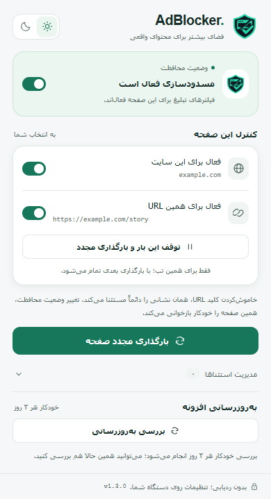
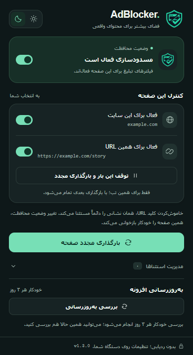

# AdBlocker


[فارسی](README.md) | **English**

An ad and tracker blocker for Chrome, Edge, and Firefox, with a Persian interface and no collection of browsing history or page content.

## Features

- Blocks 149 advertising and tracking domains and specific ad-script paths.
- Hides static and dynamic ad placements while protecting forms and media players.
- Global toggle, site and exact-URL exceptions, one-time page pauses, and light/dark themes.
- Grayscale interface when protection is off for the site or page, preserving the light/dark preference.
- Automatically reloads the current page after a protection change, without another confirmation.
- Manual update button and automatic checks every three days, with a new-version notification and GitHub Releases download link. No automatic installation.

| Light | Dark |
| --- | --- |
|  |  |

## Test results

Recorded [Turtlecute](https://adblock.turtlecute.org/) result in Edge on 2026-10-27:

| Test category | Result |
| --- | --- |
| Overall | **95%**; 126 of 132 checks |
| Hosts, as scored by the site | 95.3%; 122 of 128 checks |
| Static and dynamic cosmetic filtering | 100%; 2 of 2 checks |
| Ad-script blocking | 100%; 2 of 2 checks |

One host timed out and was counted by the site; that is not evidence of extension blocking. Percentages describe this test, not all websites or browsers. [Full report and successful CI](docs/TESTING.en.md)

## Install

Download your browser's ZIP from the [latest release](https://github.com/salehghotbani/AdBlocker/releases/latest) and extract it.

| Browser | Installation |
| --- | --- |
| Chrome 120+ | Open `chrome://extensions`, enable **Developer mode**, select **Load unpacked**, and choose the extracted folder. |
| Edge 120+ | Follow the same steps at `edge://extensions`. |
| Firefox 140+ | Open `about:debugging#/runtime/this-firefox`, select **Load Temporary Add-on**, and choose `manifest.json`. |

Packages are unsigned. Firefox installation is temporary and ends when the browser closes. Reload existing pages after installation or an update.

Some ads, especially ads embedded in video, may remain. Use a site or page exception if a website stops working. [Test results and limitations](docs/TESTING.en.md)

## Build from source

Requires Node.js 20+ and Python 3 for ZIP packaging.

```sh
npm run build
npm run package
```

Browser folders are generated in `dist/chrome`, `dist/edge`, and `dist/firefox`; ZIPs are in `dist/`. [Development and testing guide](CONTRIBUTING.en.md)

## License

[MIT](LICENSE) — © 2026 Saleh Ghotbani. Use, modification, and redistribution are permitted when retaining the copyright and license notice. Provided without warranty. [Persian translation](LICENSE.fa.md)

[Privacy](PRIVACY.en.md) · [Changelog](CHANGELOG.en.md) · [Security](SECURITY.en.md)

[Version 1.3.0 security review scope and results](docs/SECURITY-REVIEW.md)
